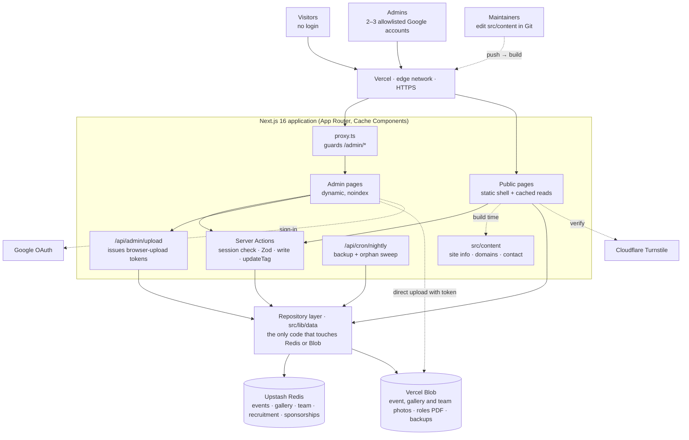
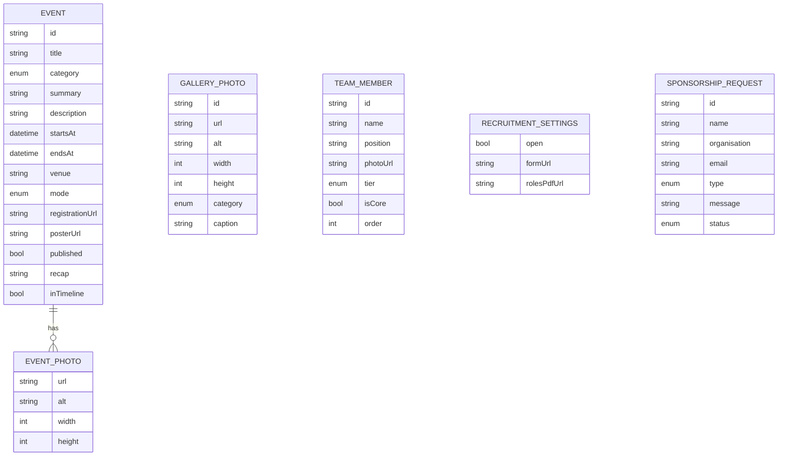
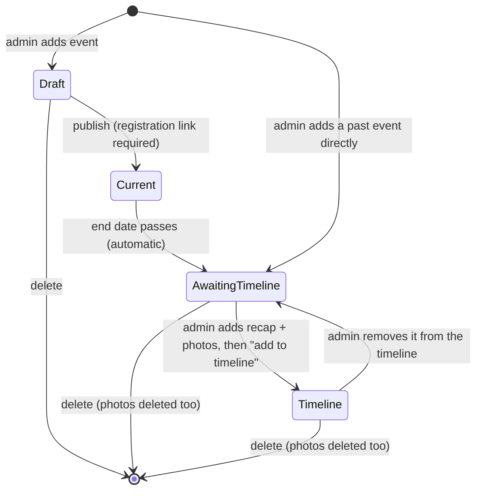
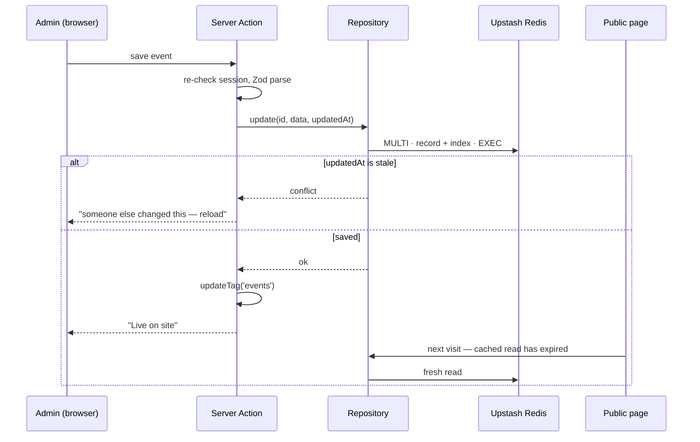
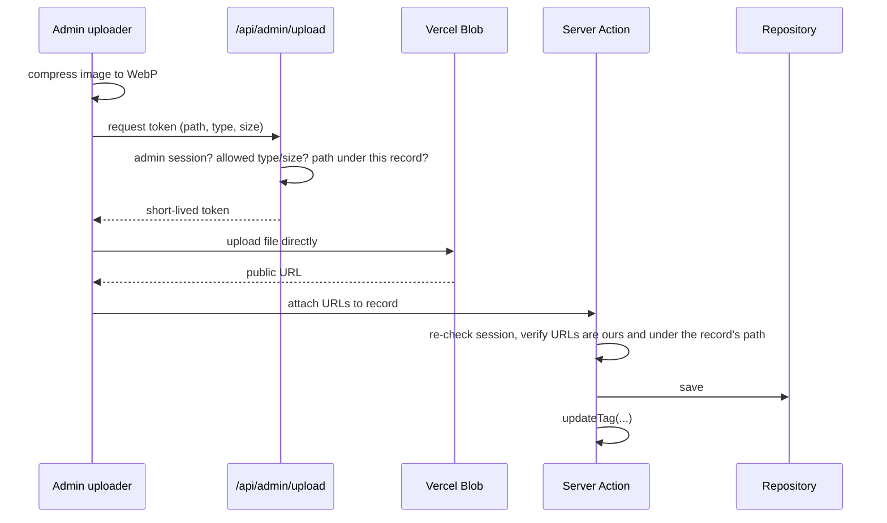

# Architecture — SIG Reality Spectra website

The current design of the site. `CLAUDE.md` holds the rules that follow from it;
`src/lib/schemas/README.md` and `src/lib/data/README.md` hold the field-level
detail. A printable proposal version with the same design is in
[`SIG_Reality_Spectra_Technical_Plan.pdf`](./SIG_Reality_Spectra_Technical_Plan.pdf);
if the two ever disagree, this file wins. Product and design decisions, with
their reasons, are in [`DECISIONS.md`](./DECISIONS.md).

---

## 1. What the site does

**Public side — six pages, no login**

| Page           | Content                                                                                                                   |
| -------------- | ------------------------------------------------------------------------------------------------------------------------- |
| `/` Home       | Hero (club name + one-line intro) · mission, vision and short "about us" · core team members                              |
| `/about`       | Club details · all team members (name, photo, position) arranged by hierarchy                                             |
| `/events`      | Current event on top (details + registration link) · timeline of past events with photos                                  |
| `/gallery`     | Every photo — from timeline events and standalone club photos — filterable by category: workshops, hackathons, meetups, … |
| `/recruitment` | The club's domains, always visible · roles PDF + Google Form link, **only while recruitment is open**                     |
| `/contact`     | Contact details · sponsorship/collaboration request form                                                                  |

**Admin side — five tools, Google sign-in with an allowlist**

| Page                  | Content                                                                                                                     |
| --------------------- | --------------------------------------------------------------------------------------------------------------------------- |
| `/admin/events`       | Add the current event · complete ended events with a recap and photos · put them on the timeline · add past events directly |
| `/admin/gallery`      | Upload standalone club photos with a category and alt text; remove them. Event photos are managed in the event              |
| `/admin/team`         | Add, edit, reorder and remove members; mark core members                                                                    |
| `/admin/recruitment`  | Open/close recruitment · upload the roles PDF · set the Google Form link                                                    |
| `/admin/sponsorships` | Read requests sent from `/contact` and mark their status — the admin inbox is the only channel, there is no email           |

`/admin` is a dashboard (upcoming events, events awaiting the timeline, new
requests, recruitment status) and `/admin/login` is the sign-in page.

---

## 2. System overview

Public pages call Server Actions only for the sponsorship form. Every other
Server Action is admin-only and re-checks the session.

---

## 3. Where each piece of data lives

| Entity                        | Store         | Edited at            | Cache tag      | Read by                           |
| ----------------------------- | ------------- | -------------------- | -------------- | --------------------------------- |
| SiteInfo, Domain, ContactInfo | `src/content` | Git                  | — (build time) | Home, About, Recruitment, Contact |
| Event + EventPhoto            | Redis + Blob  | `/admin/events`      | `events`       | Events, Gallery                   |
| GalleryPhoto (standalone)     | Redis + Blob  | `/admin/gallery`     | `gallery`      | Gallery                           |
| TeamMember                    | Redis + Blob  | `/admin/team`        | `team`         | Home (core only), About (all)     |
| RecruitmentSettings           | Redis + Blob  | `/admin/recruitment` | `recruitment`  | Recruitment, nav call to action   |
| SponsorshipRequest            | Redis         | `/contact` form      | none           | `/admin/sponsorships` only        |

The gallery page shows two sources together, grouped by category and newest
first: the photos of events on the timeline (category taken from the event) and
standalone `GALLERY_PHOTO` records. Events and gallery photos share one `Category`
enum — workshop, hackathon, meetup, talk, competition, other — so the filters mean
the same thing for both. Standalone photos can grow without limit, so the page
renders the first batch and loads more on request, with blur placeholders and
stored dimensions so nothing shifts as images arrive.

---

## 4. Event lifecycle

An event's phase is **computed at request time from its dates and flags**. It is
never stored, so nothing has to run when a date passes.

| Phase             | Visible on                            | Rule                                                |
| ----------------- | ------------------------------------- | --------------------------------------------------- |
| Draft             | admin                                 | not published, not ended                            |
| Current           | top of `/events`, admin               | published and not yet ended; soonest first          |
| Awaiting timeline | admin only ("kept for later")         | ended and not on the timeline                       |
| Timeline          | `/events` timeline, `/gallery`, admin | on the timeline — requires a past end and ≥ 1 photo |

---

## 5. Caching and live updates

The project enables **Cache Components** (`cacheComponents: true`). Public reads
are cached functions; admin writes expire exactly the tags they touch.

| Page           | Rendering                                                              | Tags                |
| -------------- | ---------------------------------------------------------------------- | ------------------- |
| `/`            | static shell · cached core team                                        | `team`              |
| `/about`       | static shell · cached team                                             | `team`              |
| `/events`      | static shell · cached events · current/past split after `connection()` | `events`            |
| `/gallery`     | static shell · cached timeline photos + cached standalone photos       | `events`, `gallery` |
| `/recruitment` | static shell · cached settings                                         | `recruitment`       |
| `/contact`     | fully static · form posts to a Server Action                           | —                   |
| site layout    | navigation · recruitment status on the call to action                  | `recruitment`       |
| `/admin/*`     | dynamic per request, uncached reads, inside `<Suspense>`               | —                   |

Rules:

- **Nothing inside a `'use cache'` function reads the current time.** "Current"
  vs "past" is decided in the page after `await connection()`, so an event moves
  to the past exactly when its end passes, without any write.
- **`updateTag` is called only from Server Actions** — it cannot run in route
  handlers. That shapes the upload flow below.

---

## 6. Uploads

Event photos, gallery photos, posters, team photos and the roles PDF never pass
through a Server Action: function request bodies are size-capped and an event or
the gallery can take dozens of photos at once.

| Upload        | Blob path                             | Limits                                |
| ------------- | ------------------------------------- | ------------------------------------- |
| Event poster  | `events/{eventId}/poster-{rand}.webp` | image, cropped to a fixed ratio       |
| Event photos  | `events/{eventId}/photos/{rand}.webp` | images, ≤ 60 per event                |
| Gallery photo | `gallery/{photoId}-{rand}.webp`       | image, alt text and category required |
| Team photo    | `team/{memberId}-{rand}.webp`         | image, square crop                    |
| Roles PDF     | `recruitment/roles-{rand}.pdf`        | PDF only                              |
| Backups       | `backups/{yyyy-mm-dd}.json`           | written by the nightly job; 30 kept   |

For a **new** record (a new gallery photo, event or team member) the token route
mints the record's id and returns it with the token, so the upload path is fixed
before the file exists and the Server Action can check the URL against it.

Deleting a record deletes its files; replacing a file deletes the old one. Files
uploaded but never attached (a closed tab mid-upload) are removed by the nightly
orphan sweep, which treats every URL referenced by an event, gallery photo, team
member or the recruitment settings as live.

---

## 7. Security

| Layer          | Control                                                                                                            |
| -------------- | ------------------------------------------------------------------------------------------------------------------ |
| Public surface | No links to `/admin` · `noindex` on admin · `robots.txt` disallows `/admin` and `/api/` · CSP and security headers |
| Identity       | Google sign-in via Auth.js · `ADMIN_EMAILS` allowlist · 8-hour JWT sessions · no user table                        |
| Route guard    | `proxy.ts` blocks `/admin/*` without a session                                                                     |
| Action guard   | Every admin Server Action and the upload-token route re-check the session (401)                                    |
| Public form    | Honeypot · Cloudflare Turnstile · 3 requests per IP per hour · Zod                                                 |
| Data           | Zod on every write and read · stale-write rejection · server-only env module                                       |
| Scheduled job  | `/api/cron/nightly` accepts only `Authorization: Bearer $CRON_SECRET`                                              |

Sponsorship requests are stored and read in the admin panel only. There is no
email integration, so there is no mail provider account, sending domain or
delivery failure to handle; the dashboard shows a "new requests" count instead.

---

## 8. Environments

| Environment | `REDIS_KEY_PREFIX` | Purpose                                        |
| ----------- | ------------------ | ---------------------------------------------- |
| Local       | `sig:dev`          | development                                    |
| Preview     | `sig:preview`      | one deployment per pull request; e2e runs here |
| Production  | `sig:prod`         | club domain; nightly backup and orphan sweep   |

---

## 9. What changed in this revision

Removed as redundant with the new scope:

- Pages: Projects, Achievements, Resources, Join (now **Recruitment**), Team
  (merged into **About**), Collaborate (merged into **Contact**).
- Detail routes: `/projects/[slug]`, `/events/[slug]`, `/gallery/[album]`.
- Event slugs and manual event ordering — the timeline is chronological.
- Sponsor brochure, CSV export and acknowledgement emails to submitters.
- Admin "Enquiries" (now **Sponsorships**).

Added:

- Admin-managed **team members** with photos, hierarchy tier and core flag.
- **Past-event photos**, the timeline step, and the **gallery derived from them**.
- **Recruitment PDF** alongside the Google Form link, with domains always visible.
- `cacheComponents` enabled, which `cacheTag` requires.
- Browser-direct uploads with a token route, and a nightly orphan sweep.
- `CRON_SECRET` for the nightly job.

---

## 10. Revision 3 — decisions after the team review

Recorded in [`DECISIONS.md`](./DECISIONS.md):

- **Gallery has two sources.** New `GalleryPhoto` entity, `gallery` cache tag,
  shared `Category` enum, `/admin/gallery` (a fifth admin tool), and a Blob path
  `gallery/{photoId}-{rand}.webp`.
- **No email.** Resend and its three environment variables are removed;
  sponsorship requests live in the admin inbox.
- **One WebGL context in the hero, no `ogl`, no rule-4 exceptions.** These are
  constraints on the Stage 2 build rather than changes to this architecture.
