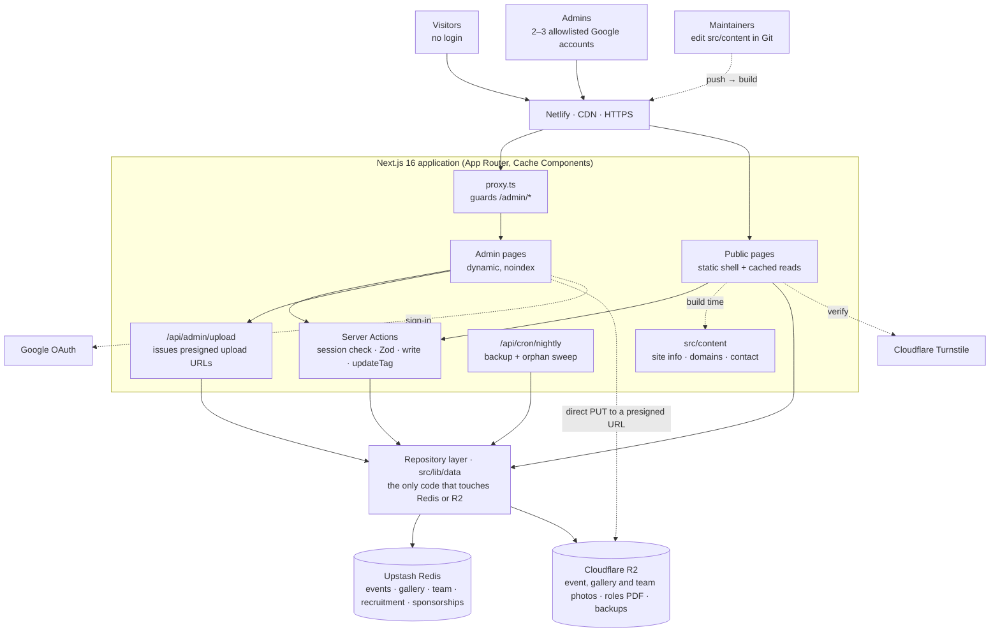
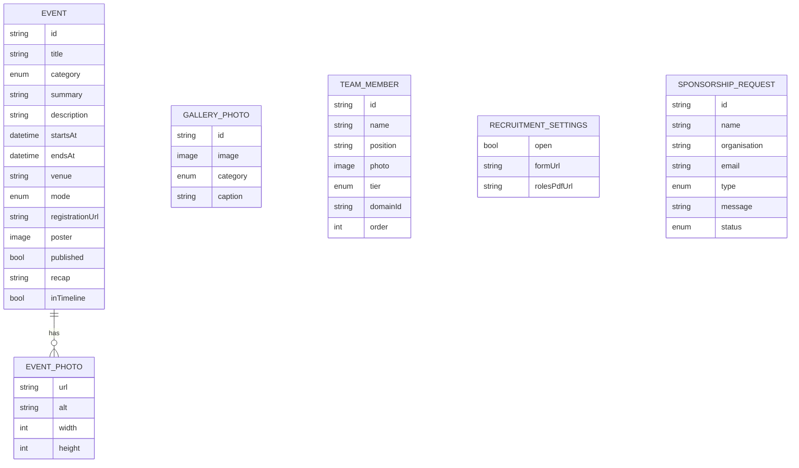
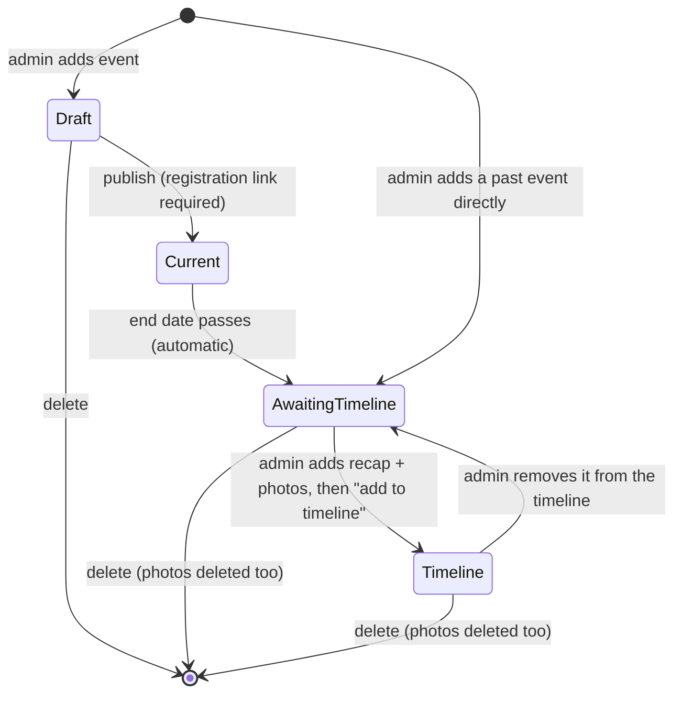
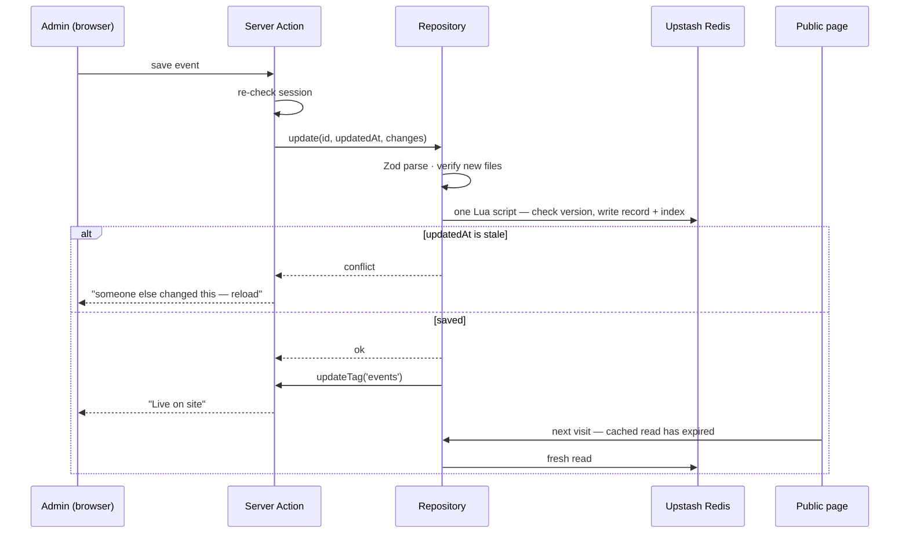
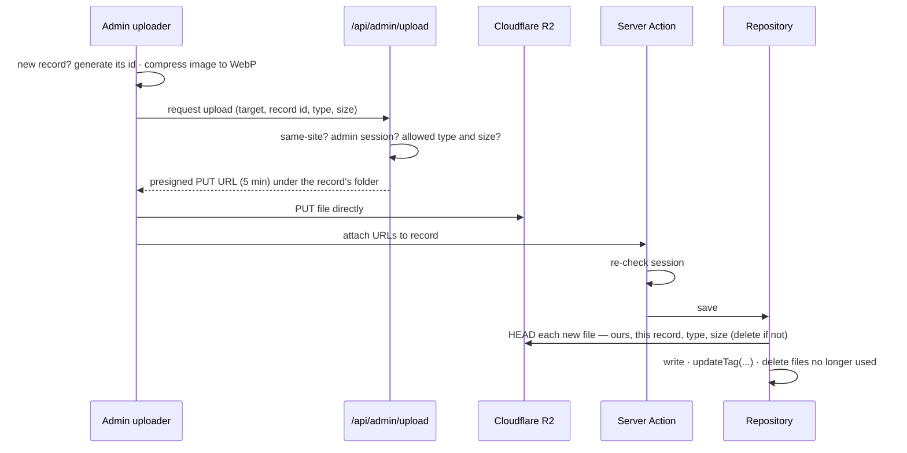

# Architecture — SIG Reality Spectra website

The current design of the site. `CLAUDE.md` holds the rules that follow from it;
`src/lib/schemas/README.md` and `src/lib/data/README.md` hold the field-level
detail. A printable proposal version with the same design is in
[`SIG_Reality_Spectra_Technical_Plan.pdf`](./SIG_Reality_Spectra_Technical_Plan.pdf);
if the two ever disagree, this file wins. Product and design decisions, with
their reasons, are in [`DECISIONS.md`](./DECISIONS.md).

---

## 1. What the site does

**Public side — six pages, no login**

| Page           | Content                                                                                                             |
| -------------- | ------------------------------------------------------------------------------------------------------------------- |
| `/` Home       | Hero (club name + one-line intro) · mission, vision and short "about us" · domains overview (no team, D-027)        |
| `/about`       | Club details · the core team, then the secretary of each domain (name, photo, position)                             |
| `/events`      | Current event on top (details + registration link) · timeline of past events with photos                            |
| `/gallery`     | Every photo — from timeline events and standalone club photos — filterable by category: hackathons, competitions, … |
| `/recruitment` | The club's domains, always visible · Google Form link while recruitment is open, plus the roles PDF once uploaded   |
| `/contact`     | Contact details · sponsorship/collaboration request form                                                            |

**Admin side — five tools, Google sign-in with an allowlist**

| Page                  | Content                                                                                                                     |
| --------------------- | --------------------------------------------------------------------------------------------------------------------------- |
| `/admin/events`       | Add the current event · complete ended events with a recap and photos · put them on the timeline · add past events directly |
| `/admin/gallery`      | Upload standalone club photos with a category and alt text; remove them. Event photos are managed in the event              |
| `/admin/team`         | Add, edit, reorder and remove members: the core team, and one secretary per domain                                          |
| `/admin/recruitment`  | Open/close recruitment · upload the roles PDF · set the Google Form link                                                    |
| `/admin/sponsorships` | Read requests sent from `/contact` and mark their status — the admin inbox is the only channel, there is no email           |

`/admin` is a dashboard (upcoming events, events awaiting the timeline, new
requests, recruitment status) and `/admin/login` is the sign-in page.

---

## 2. System overview

Public pages call Server Actions only for the sponsorship form. Every other
Server Action is admin-only and re-checks the session.

---

## 3. Where each piece of data lives

| Entity                        | Store         | Edited at            | Cache tag      | Read by                           |
| ----------------------------- | ------------- | -------------------- | -------------- | --------------------------------- |
| SiteInfo, Domain, ContactInfo | `src/content` | Git                  | — (build time) | Home, About, Recruitment, Contact |
| Event + EventPhoto            | Redis + R2    | `/admin/events`      | `events`       | Events, Gallery                   |
| GalleryPhoto (standalone)     | Redis + R2    | `/admin/gallery`     | `gallery`      | Gallery                           |
| TeamMember                    | Redis + R2    | `/admin/team`        | `team`         | About                             |
| RecruitmentSettings           | Redis + R2    | `/admin/recruitment` | `recruitment`  | Recruitment, nav call to action   |
| SponsorshipRequest            | Redis         | `/contact` form      | none           | `/admin/sponsorships` only        |

Until Stage 8, recruitment status and the form link come from the interim
`src/content/recruitment.json` (D-024), validated by the RecruitmentSettings
input schema itself (D-028); the Recruitment page reads the same fields, so the
switch changes no page.

Every stored record also carries `createdAt`, `updatedAt` (its version for
the stale-edit check) and `updatedBy`.

The gallery page shows two sources together, grouped by category and newest
first: the photos of events on the timeline (category taken from the event) and
standalone `GALLERY_PHOTO` records. Events and gallery photos share one `Category`
enum — hackathon, competition, workshop, other (D-026) — so the filters mean
the same thing for both. Standalone photos can grow without limit, so the page
renders the first batch and loads more on request, with blur placeholders and
stored dimensions so nothing shifts as images arrive.

---

## 4. Event lifecycle

An event's phase is **computed at request time from its dates and flags**. It is
never stored, so nothing has to run when a date passes.

| Phase             | Visible on                            | Rule                                                |
| ----------------- | ------------------------------------- | --------------------------------------------------- |
| Draft             | admin                                 | not published, not ended                            |
| Current           | top of `/events`, admin               | published and not yet ended; soonest first          |
| Awaiting timeline | admin only ("kept for later")         | ended and not on the timeline                       |
| Timeline          | `/events` timeline, `/gallery`, admin | on the timeline — requires a past end and ≥ 1 photo |

An event without an end time ends at the end of its start day, India Standard
Time.

---

## 5. Caching and live updates

The project enables **Cache Components** (`cacheComponents: true`). Public reads
are cached functions; admin writes expire exactly the tags they touch.

| Page           | Rendering                                                              | Tags                |
| -------------- | ---------------------------------------------------------------------- | ------------------- |
| `/`            | fully static (Git content only)                                        | —                   |
| `/about`       | static shell · cached team (core, then secretaries)                    | `team`              |
| `/events`      | static shell · cached events · current/past split after `connection()` | `events`            |
| `/gallery`     | static shell · cached timeline photos + cached standalone photos       | `events`, `gallery` |
| `/recruitment` | static shell · cached settings                                         | `recruitment`       |
| `/contact`     | fully static · form posts to a Server Action                           | —                   |
| site layout    | navigation · recruitment status on the call to action                  | `recruitment`       |
| `/admin/*`     | dynamic per request, uncached reads, inside `<Suspense>`               | —                   |

Rules:

- **Nothing inside a `'use cache'` function reads the current time.** "Current"
  vs "past" is decided in the page after `await connection()`, so an event moves
  to the past exactly when its end passes, without any write.
- **`updateTag` is called only from Server Actions** — it cannot run in route
  handlers. That shapes the upload flow below.
- Public reads use `cacheLife('hours')`. Admin saves refresh them at once; the
  lifetime only bounds changes made outside the panel (the seed script).
- On Netlify, Cache Components and tag invalidation are supported by its
  Next.js runtime (D-025); confirmed on the first deploy with data
  (OPEN_ITEMS #26).

---

## 6. Uploads

Event photos, gallery photos, posters, team photos and the roles PDF never pass
through a Server Action: function request bodies are size-capped and an event or
the gallery can take dozens of photos at once.

| Upload        | R2 key (under `{DATA_NAMESPACE}/`)    | Limits                                       |
| ------------- | ------------------------------------- | -------------------------------------------- |
| Event poster  | `events/{eventId}/poster/{rand}.webp` | image ≤ 5 MB, cropped to a fixed ratio       |
| Event photos  | `events/{eventId}/photos/{rand}.webp` | images ≤ 5 MB, ≤ 60 per event                |
| Gallery photo | `gallery/{photoId}/{rand}.webp`       | image ≤ 5 MB, alt text and category required |
| Team photo    | `team/{memberId}/{rand}.webp`         | image ≤ 5 MB, square crop                    |
| Roles PDF     | `recruitment/{rand}.pdf`              | PDF ≤ 10 MB                                  |
| Backups       | `backups/{yyyy-mm-dd}.json`           | written by the nightly job; 30 kept          |

For a **new** record the admin UI generates the record's id in the browser
before uploading, so the upload path is fixed before the file exists and the
save can check every URL against it. A presigned PUT cannot cap a file's size,
which is why the size and type are checked again on save.

Deleting a record deletes its files; replacing a file deletes the old one. Files
uploaded but never attached (a closed tab mid-upload) are removed by the nightly
orphan sweep, which treats every URL referenced by an event, gallery photo, team
member or the recruitment settings as live.

---

## 7. Security

| Layer          | Control                                                                                                                                                           |
| -------------- | ----------------------------------------------------------------------------------------------------------------------------------------------------------------- |
| Public surface | No links to `/admin` · `noindex` on admin · `robots.txt` disallows `/admin` and `/api/` · CSP and security headers                                                |
| Identity       | Google sign-in via Auth.js · `ADMIN_EMAILS` allowlist, re-checked on every request · 8-hour JWT sessions · no user table · local-only development sign-in (D-030) |
| Route guard    | `proxy.ts` sends `/admin/*` without a session to `/admin/login`, returning only to `/admin` paths; the panel layout checks again                                  |
| Action guard   | Every admin Server Action runs inside `adminAction()`, which re-checks the session; the upload route checks it too (401) and refuses cross-site requests          |
| Public form    | Honeypot · Cloudflare Turnstile · 3 requests per IP per hour · Zod                                                                                                |
| Data           | Zod on every write and read · stale-write rejection · server-only env module                                                                                      |
| Scheduled job  | `/api/cron/nightly` accepts only `Authorization: Bearer $CRON_SECRET`                                                                                             |

Sponsorship requests are stored and read in the admin panel only. There is no
email integration, so there is no mail provider account, sending domain or
delivery failure to handle; the dashboard shows a "new requests" count instead.

---

## 8. Environments

| Environment | `DATA_NAMESPACE` | Purpose                                                                                                    |
| ----------- | ---------------- | ---------------------------------------------------------------------------------------------------------- |
| Local       | `dev`            | development; `DATA_BACKEND=local` keeps it in `.data/` until Upstash/R2 exist; `pnpm seed --demo` fills it |
| Preview     | `preview`        | Netlify deploy previews and branch deploys                                                                 |
| Production  | `prod`           | club domain; nightly backup and orphan sweep                                                               |
| Live tests  | `test-…`         | throwaway, created and removed by `pnpm test:live`                                                         |

One Upstash database and one R2 bucket serve every environment; the namespace
prefixes every Redis key (`sig:{ns}:…`) and R2 object (`{ns}/…`). Netlify
sets `CONTEXT` on each build, and the build fails if production is not
`prod` or a preview is.

---

## 9. What changed in this revision

Removed as redundant with the new scope:

- Pages: Projects, Achievements, Resources, Join (now **Recruitment**), Team
  (merged into **About**), Collaborate (merged into **Contact**).
- Detail routes: `/projects/[slug]`, `/events/[slug]`, `/gallery/[album]`.
- Event slugs and manual event ordering — the timeline is chronological.
- Sponsor brochure, CSV export and acknowledgement emails to submitters.
- Admin "Enquiries" (now **Sponsorships**).

Added:

- Admin-managed **team members** with photos and hierarchy tier.
- **Past-event photos**, the timeline step, and the **gallery derived from them**.
- **Recruitment PDF** alongside the Google Form link, with domains always visible.
- `cacheComponents` enabled, which `cacheTag` requires.
- Browser-direct uploads with a token route, and a nightly orphan sweep.
- `CRON_SECRET` for the nightly job.

---

## 10. Revision 3 — decisions after the team review

Recorded in [`DECISIONS.md`](./DECISIONS.md):

- **Gallery has two sources.** New `GalleryPhoto` entity, `gallery` cache tag,
  shared `Category` enum, `/admin/gallery` (a fifth admin tool), and its own
  file path.
- **No email.** Resend and its three environment variables are removed;
  sponsorship requests live in the admin inbox.
- **One WebGL context in the hero, no `ogl`, no rule-4 exceptions.** These are
  constraints on the Stage 2 build rather than changes to this architecture.

## 11. Revision 4 — Stage 5 on Netlify

Recorded in [`DECISIONS.md`](./DECISIONS.md) D-025 – D-029:

- **Hosting is Netlify**; files moved from Vercel Blob to **Cloudflare R2**
  (presigned browser uploads); Upstash is used directly; the nightly job will
  run from a Netlify scheduled function.
- **`DATA_NAMESPACE`** replaces `REDIS_KEY_PREFIX` and covers R2 too.
- **Categories** are hackathon, competition, workshop, other.
- **Team** is the core team plus one secretary per domain, on About only; the
  home page has no team section and the `isCore` flag is gone.
- **Recruitment** opens with the form link alone; the roles PDF is optional.
- **Writes** are one atomic Lua script per save instead of MULTI/EXEC, and the
  data layer is one generic repository over two storage ports.

## 12. Revision 5 — Stage 6, admin access

Recorded in [`DECISIONS.md`](./DECISIONS.md) D-030:

- Built with **placeholder credentials**: Google sign-in switches on when its
  keys are set; until then a **development sign-in** works on a developer's
  machine only. Temporary admin: `dryerisdry@gmail.com`.
- The panel lives under `src/app/admin/(panel)`; `/admin/login` is outside it.
- Admin Server Actions return an `ActionResult` through `adminAction()`.
- The dashboard reads the data store per request and lists which outside
  services still lack credentials.

## 13. Revision 6 — Stage 7, events and gallery

Recorded in [`DECISIONS.md`](./DECISIONS.md) D-031:

- **Local data mode** (`DATA_BACKEND=local`) stands in for Upstash and R2 on a
  developer's computer: a JSON file of records and a folder of files in
  `.data/`, with the same signed-upload flow through `/api/local-media`.
  Refused on Netlify.
- **/admin/events** (list by phase, editor for new and existing events, recap,
  photos, timeline) and **/admin/gallery** (batch upload, edit, delete), built
  on react-hook-form with the one schema per entity.
- **/events** shows current events (posters whole in a 4:5 frame, register
  link) and the timeline; **/gallery** shows both photo sources with category
  filters, "show more" and a full-size viewer.
- Images of any ratio; descriptions and recaps are plain text.
- Content is placeholder (`[Demo]`) until the club supplies events and photos.
